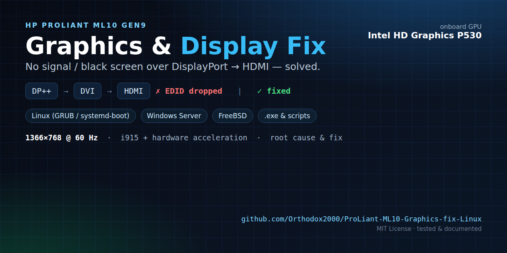
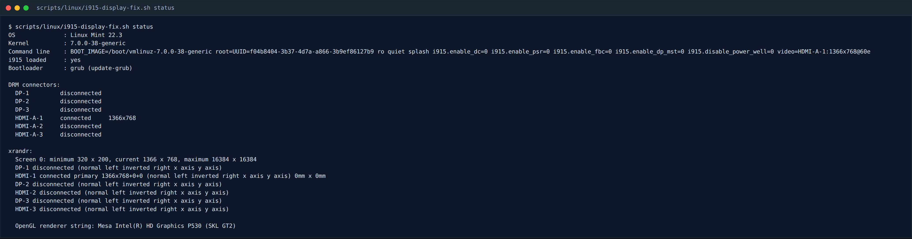
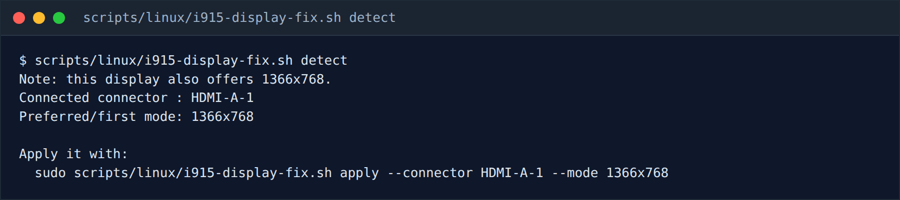
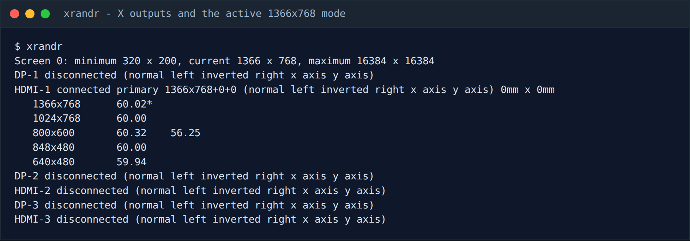
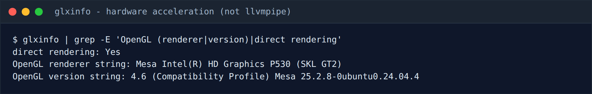
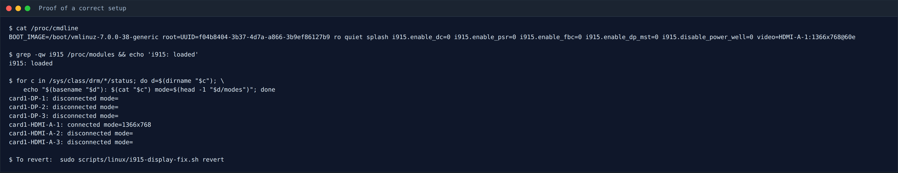
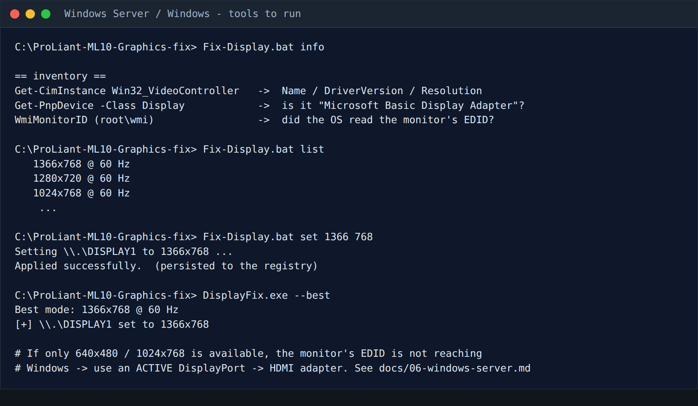

# HP ProLiant ML10 Gen9 — Graphics / Display Fix (Linux, Windows Server & more)

> **Symptom:** the onboard Intel graphics (HD Graphics **P530**, `8086:191d`)
> works fine under `nomodeset` only at a fixed **1024×768**, but as soon as you
> remove `nomodeset` — or on Windows Server — the display goes **black / “no
> signal”**. This repository is the complete, tested, documented fix: root-cause
> analysis, ready-to-run scripts for many distributions, Windows Server
> instructions, hardware/cable alternatives, and full troubleshooting.

Tested reference machine: **HPE ProLiant ML10 Gen9**, Xeon E3-1225 v5,
2× DisplayPort 1.2, monitor over **DP → DVI → HDMI**, Linux Mint 22.x.
Result: **1366×768 @ 60 Hz** with full hardware acceleration.

> 📄 **New here?** Read [**QUICKSTART.md**](QUICKSTART.md) first.
> 🖨️ **Printable / offline:** [**docs/dist/ProLiant-ML10-Graphics-fix.pdf**](docs/dist/ProLiant-ML10-Graphics-fix.pdf)
> (all documentation in one 49-page PDF) — see [Screenshots](#screenshots).

---

## TL;DR — the fix

The machine needs `i915` (the Intel KMS driver) to own the display, and the
output must be **force-enabled** because the DP→DVI→HDMI adapter chain does not
pass EDID reliably:

```
# Linux kernel command line (remove nomodeset, add):
i915.enable_dc=0 i915.enable_psr=0 i915.enable_fbc=0 \
i915.enable_dp_mst=0 i915.disable_power_well=0 \
video=HDMI-A-1:1366x768@60e
```

Run the toolkit and let it do it for you:

```bash
./scripts/linux/i915-display-fix.sh status      # inspect
./scripts/linux/i915-display-fix.sh detect      # find your connector + mode
sudo ./scripts/linux/i915-display-fix.sh apply  # apply permanently
sudo reboot
```

On **Windows Server / Windows** there is no kernel command line — you install
the Intel graphics driver and (if needed) use an *active* DisplayPort adapter.
See **[docs/06-windows-server.md](docs/06-windows-server.md)**.

---

## Table of contents

| # | Document | What it covers |
|---|----------|----------------|
| 1 | [Problem statement](docs/01-problem-statement.md) | Symptoms, affected hardware, scope |
| 2 | [Diagnosis & evidence](docs/02-diagnosis-and-evidence.md) | How it was found, commands, real logs |
| 3 | [Root cause](docs/03-root-cause.md) | `nomodeset`, EDID/GMBUS, DDI B dual-name, Skylake power wells |
| 4 | [Linux solution](docs/04-linux-solution.md) | The fix, step-by-step, every parameter explained |
| 5 | [Distro & bootloader guide](docs/05-distro-guide.md) | Ubuntu, Debian, Mint, Fedora, RHEL, Arch, openSUSE, NixOS, systemd-boot |
| 6 | [Windows Server / Windows](docs/06-windows-server.md) | Drivers, resolution, active adapter, RDP, PowerShell, .exe |
| 7 | [Other OSes](docs/07-other-os.md) | FreeBSD, Proxmox/ESXi, TrueNAS, pfSense/OPNsense, illumos |
| 8 | [Hardware, cables & adapters](docs/08-hardware-cables-adapters.md) | Active vs passive DP, adapters, KVMs, alternative outputs |
| 9 | [Troubleshooting](docs/09-troubleshooting.md) | Decision tree for “still dark”, wrong resolution, etc. |
| 10 | [Verification](docs/10-verification.md) | Prove it worked, on any OS |
| 11 | [Reference](docs/11-reference.md) | Kernel params, `video=` syntax, `drm.debug`, glossary |
| 12 | [FAQ](docs/12-faq.md) | Sharp questions and answers |

---

## Repository layout

```
ProLiant-ML10-Graphics-fix-Linux/
├── README.md                        ← you are here
├── QUICKSTART.md                    ← 60-second version
├── LICENSE                          ← MIT
├── CITATION.cff                     ← “Cite this repository” metadata
├── AUTHORS                          ← maintainer + how to cite
├── CHANGELOG.md
├── Makefile                         ← build .exe, PDF, screenshots, lint
├── install.sh                       ← install Linux toolkit to /usr/local/sbin
├── docs/                            ← the full write-up (see table above)
│   └── dist/                        ← generated PDF + HTML (all docs combined)
├── scripts/
│   ├── linux/
│   │   ├── i915-display-fix.sh      ← portable toolkit (detect/apply/revert/discover)
│   │   ├── i915-collect.sh          ← gather diagnostics from a failing boot
│   │   ├── finalize-i915.sh         ← one-shot, non-interactive apply
│   │   └── README.md
│   ├── windows/
│   │   ├── Get-GraphicsInfo.ps1     ← inventory GPU + displays
│   │   ├── Set-DisplayResolution.ps1← set resolution / list modes
│   │   ├── Install-IntelGraphicsDriver.ps1
│   │   ├── Fix-Display.bat          ← double-click wrapper
│   │   ├── DisplayFix.exe           ← prebuilt native tool
│   │   ├── src/DisplayFix.c         ← source of the tiny native .exe
│   │   └── README.md
│   ├── freebsd/
│   │   ├── i915-freebsd.sh
│   │   └── README.md
│   └── doc/
│       ├── build-pdf.sh             ← Markdown -> HTML -> Chrome -> PDF
│       ├── make-screenshots.sh      ← render real output as terminal PNGs
│       └── make-banner.sh           ← render the social-preview banner
├── examples/                        ← real logs/cmdlines from the reference machine
├── assets/
│   ├── architecture.svg             ← signal-chain diagram
│   ├── social-preview.png           ← repo banner (1280x640)
│   ├── social/                      ← shareable post images (1200x627, 1080x1080)
│   └── screenshots/                 ← generated terminal captures
└── .github/workflows/ci.yml         ← shellcheck + syntax + Windows build CI
```

---

## Why this repository exists

The ML10 Gen9 is a cheap, quiet Xeon tower with **two DisplayPort 1.2 outputs**
on the motherboard and **no HDMI**. Most people connect a monitor meant for HDMI
through a cheap **DP→DVI→HDMI** (or DP→HDMI) adapter. The result is a machine that
“has no video” under a real graphics driver. Every forum answer says one of:

- “Use `nomodeset`” → you get 1024×768 forever and no GPU acceleration;
- “Use an active adapter” → correct, but nobody explains *why*, or how to make a
  passive one work;
- “The ML10 has no iGPU support” → **false**, the P530 is fully supported.

This repository documents the actual technical cause and gives a **software fix
that works with a passive adapter**, plus the hardware fix if you prefer it, on
**every OS we could test or verify**.

---

## Screenshots

Everything below is the **real output of the reference machine**, captured with
[`scripts/doc/make-screenshots.sh`](scripts/doc/make-screenshots.sh) (it runs the
commands and rasterises their output — nothing is mocked up).

| Toolkit status (`i915-display-fix.sh status`) | Connector detection (`… detect`) |
|---|---|
|  |  |

| X outputs (`xrandr`) | Hardware acceleration (`glxinfo`) |
|---|---|
|  |  |

**Proof of a correct setup** — `nomodeset` gone, `i915` loaded, one connector
enabled at 1366×768:



**Windows Server / Windows** — the tools you run there
(see [`docs/06-windows-server.md`](docs/06-windows-server.md)):



> The signal-chain diagram at the top of the
> [PDF](docs/dist/ProLiant-ML10-Graphics-fix.pdf) is
> [`assets/architecture.svg`](assets/architecture.svg).

---

## Affected / similar hardware

Anything with these Intel generations behaves the same way over a passive
DP→DVI/HDMI chain:

| Generation | iGPU examples | PCI IDs |
|---|---|---|
| **Skylake** (this repo) | HD Graphics **P530**, 530, Iris 540/550 | `191d`, `1912`, `1916`, `1926/27` |
| Broadwell | HD 5500/5600, Iris Pro 6200 | `1616`, `1622`, `1626` |
| Kaby Lake | HD 630, Iris Plus 640/650 | `5912`, `5916`, `5926` |
| Coffee Lake | UHD 630 | `3e92`, `3e9b` |
| Comet/Tiger Lake | UHD/Iris Xe | `9b41`, `9a49` |

The same `nomodeset` + EDID-force-enable technique applies to all of them.

---

## Safety

- Every script is **non-destructive by default** and keeps timestamped backups
  (`/var/backups/i915-display-fix/`).
- A guaranteed **recovery boot entry** (`nomodeset`) is always left in place, so
  a bad change is never permanent.
- `apply --dry-run` shows exactly what will change and touches nothing.

> ⚠️ The scripts edit the bootloader configuration. Read the relevant docs first,
> and keep a way to reach a console (physical keyboard or SSH enabled beforehand)
> if you are changing display settings on a machine you cannot see.

---

## Citation

If this helped you (or you reference it), please cite it. The metadata lives in
[`CITATION.cff`](CITATION.cff) (GitHub shows a **“Cite this repository”** button),
and [`AUTHORS`](AUTHORS) has a ready-made BibTeX entry.

```bibtex
@misc{orthodox2000_ml10gen9_graphics_fix,
  author       = {Orthodox2000},
  title        = {HP ProLiant ML10 Gen9 --- Graphics / Display Fix
                  (Linux, Windows Server \& more)},
  year         = {2026},
  version      = {1.1.0},
  howpublished = {GitHub repository},
  url          = {https://github.com/Orthodox2000/ProLiant-ML10-Graphics-fix-Linux},
  note         = {MIT License}
}
```

---

## License

MIT — see [LICENSE](LICENSE). Not affiliated with HPE or Intel. Use at your own
risk; no warranty.

## Contributing

Tested this on another board, distro or monitor? Please open a PR updating the
matrices in `docs/05-distro-guide.md` and `docs/08-hardware-cables-adapters.md`.
