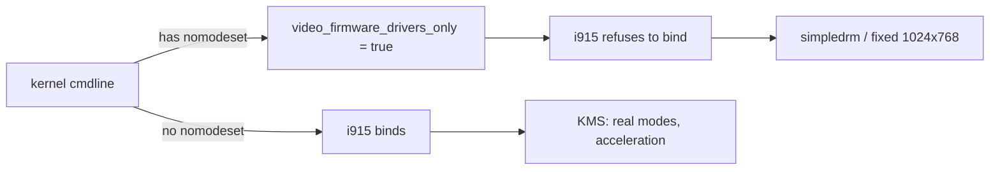

# 3. Root cause

Four independent facts combine into the failure. Understanding them tells you
which fix will work and which will not.

## 3.1 `nomodeset` is a global, boot-time kill switch

`nomodeset` sets the kernel variable `video_firmware_drivers_only()`. While it is
set, **DRM/KMS drivers are not allowed to take over** the display; only the
firmware’s simple framebuffer (`simpledrm`, driven by the BIOS GOP) is used.

Consequences:

- Resolution is whatever the firmware set at boot — here **1024×768** — and
  cannot be changed.
- No hardware acceleration; the desktop runs on software rendering (`llvmpipe`).
- `modprobe i915` fails with `No such device` (the driver declines to probe).
- **It cannot be undone at runtime.** It is read once at boot.



## 3.2 EDID does not survive the DP→DVI→HDMI chain

EDID is the small data block a monitor exposes over the DDC channel (I²C). The
driver needs it to know the monitor exists and what modes it supports.

On Intel, DDC is normally read through **GMBUS** (a hardware I²C controller).
Cheap passive adapters — and even some active ones — break or degrade DDC, so:

```
intel_hdmi_set_edid: HDMI GMBUS EDID read failed, retry using GPIO bit-banging
```

appears hundreds of times. The fallback (bit-banging GPIO) is slow and, during
early boot, often loses the race with the desktop starting. When that happens the
connector is reported **disconnected** → the output is never turned on → **“no
signal”**.

> This is why the *hardware* fix is “use an active adapter” (it regenerates DDC),
> and why the *software* fix is “force the connector on and tell the driver the
> mode” so it does not need EDID at all.

## 3.3 A dual-mode (DP++) port has two names

Intel DP++ ports can carry native DisplayPort **or** TMDS (DVI/HDMI) depending on
what is plugged in. Because of that, the driver registers **two connectors on one
physical port**, e.g.:

```
port DDI B ──┬── connector DP-1        (native DP)
             └── connector HDMI-A-1    (DP++ / TMDS)
```

The BIOS leaves the one matching the actual cable enabled. On the reference
machine `hd state readout: enabled` was on **`HDMI-A-1`**, so the cable is on the
DP++ path in HDMI mode.

**Trap:** force-enabling *both* names makes two connectors share one encoder:

```
handle_conflicting_encoders: [DDI B/PHY B] in use on pipe A, disabling HDMI-A-1
```

…and the driver disables the real monitor in a loop. This produces the notorious
“signal present, black screen, flashing cursor”.

## 3.4 Skylake-era power management can blank an output

Skylake’s display engine has aggressive power features that are known to cause
black screens / flicker on external adapters:

- **DC states** (display C-states) — `i915.enable_dc`
- **PSR** (Panel Self Refresh) — `i915.enable_psr`
- **FBC** (Frame Buffer Compression) — `i915.enable_fbc`
- **Power wells** — `i915.disable_power_well`

Disabling them (as this repo does) trades a little idle power for stability. On a
desktop/server that is the right trade.

## 3.5 Minimal working condition

Putting it together, the display lights up iff **all** of these are true:

1. `nomodeset` is **absent** (so `i915` binds).
2. The correct **connector name** is force-enabled (`video=<name>:<mode>e`),
   compensating for the missing EDID.
3. A **supported mode** is requested (here 1366×768@60).
4. Optionally, Skylake power features are disabled for stability.

Note that (2) is only necessary because of (3.2). With a good **active adapter**,
plain boot without `video=` usually works, because EDID is readable.
