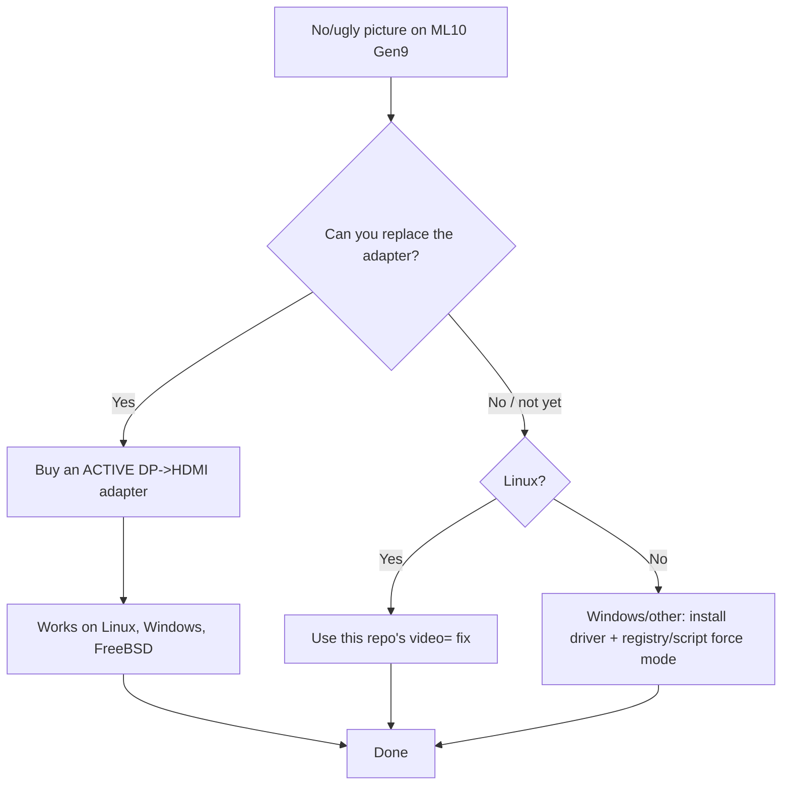

# 8. Hardware, cables, adapters & alternative solutions

Sometimes the cleanest fix is physical. This document explains the options and
why they work.

---

## 8.1 What the ML10 Gen9 actually has

The motherboard has **2 × DisplayPort 1.2** and **no HDMI/DVI/VGA**. Per the GPU
VBT (see [examples/i915-vbt-ports.txt](../examples/i915-vbt-ports.txt)), ports
B/C/D are **DP++** (dual-mode), i.e. they can emit native DisplayPort **or** TMDS
(DVI/HDMI) signals.

Two implications:

1. A **passive** DP→HDMI/DVI adapter is *electrically allowed* (DP++), which is
   why the machine sometimes gives a picture at all.
2. But passive adapters have no chip to regenerate **DDC/EDID**, so detection is
   unreliable → the failure in this repo.

> HP’s own documentation for the ML10 Gen9 states the DP ports require an
> **active** dongle. This is the “official” hardware answer.

---

## 8.2 Passive vs active adapters

| | Passive DP→HDMI/DVI | Active DP→HDMI/DVI |
|---|---|---|
| Chip inside | none | level shifter / protocol converter |
| Works when source is DP++ | sometimes | always |
| Passes EDID/DDC reliably | often **no** | yes |
| Fixes this bug | no | **yes** |
| Linux `video=` workaround needed | yes | usually not |

**How to tell them apart:** active adapters are usually slightly larger, contain
a chip, are labelled “active”, “DP++ to HDMI”, or explicitly “for NVIDIA/AMD/
non-DP++”. A “DP to HDMI passive” plug is the one causing trouble.

---

## 8.3 Recommended cables/adapters

In rough order of preference:

1. **Active DP → HDMI cable/adapter**, then a normal HDMI cable to the monitor.
   One hop, EDID regenerated, works on the ML10 out of the box.
2. **Active DP → DVI**, then DVI→HDMI cable. Also fine; two hops but the active
   DP→DVI regenerates DDC.
3. **Active DP → VGA** (if you must drive a VGA monitor; degrades quality).
4. **USB graphics adapter** (DisplayLink) — an entirely different path that
   bypasses the iGPU output; requires drivers on every OS.
5. **A monitor with DisplayPort** — remove the adapters entirely; the cleanest of
   all if you are buying hardware.

Avoid: passive DP→HDMI/DVI plugs, “DP to HDMI” cables with no chip, unpowered
KVMs with DP inputs that do not support DP++.

---

## 8.4 KVM switches

Many KVM switches present a **fake EDID** to the computer so switching does not
disturb the display. That is actually helpful here (it removes the EDID race).
Caveats:

- A KVM that does **not** emulate EDID behaves like a bad adapter.
- Prefer KVMs advertised as “supports DP++ / EDID emulation”.
- Some KVMs force a low maximum mode (e.g. 1920×1080); verify it passes your
  native resolution.

---

## 8.5 A discrete GPU alternative

If you need more outputs or guaranteed HDMI:

- Any cheap low-profile card (e.g. a GT 1030 / RX 6400 / Intel Arc A310) gives
  native HDMI/DP and sidesteps the iGPU entirely.
- The ML10 Gen9 has one PCIe x16 slot (electrically x8/x16 depending on config)
  and a modest PSU; check power and clearance first.
- On Windows Server this also often gets you a driver that actually installs,
  because discrete vendors ship server-adjacent drivers.

---

## 8.6 BIOS/firmware settings worth checking

In the ML10 Gen9 BIOS (F10 at boot):

- **Embedded Video / Onboard VGA** — ensure it is enabled (there is no discrete
  GPU, so this should default on).
- **Primary display** — if a discrete card is added, set which one POSTs.
- **Legacy vs UEFI video** — UEFI generally gives a better GOP framebuffer; the
  reference machine boots UEFI.
- **BIOS version** — the reference machine is on **1.010**; newer BIOS revisions
  occasionally improve iGPU POST behaviour.

A BIOS update is not a fix for this bug, but it is worth having current firmware.

---

## 8.7 What *not* to do

- **Do not rely on `nomodeset`** as a “fix”. It permanently caps you at the
  firmware resolution with no acceleration.
- **Do not disable the iGPU** to “avoid conflicts” — you have no other GPU.
- **Do not buy a second passive adapter** hoping a different brand behaves better;
  the mechanism is the same. Buy *active*.

---

## 8.8 Decision guide

